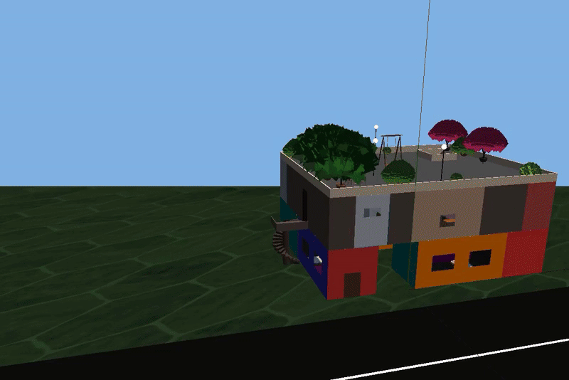
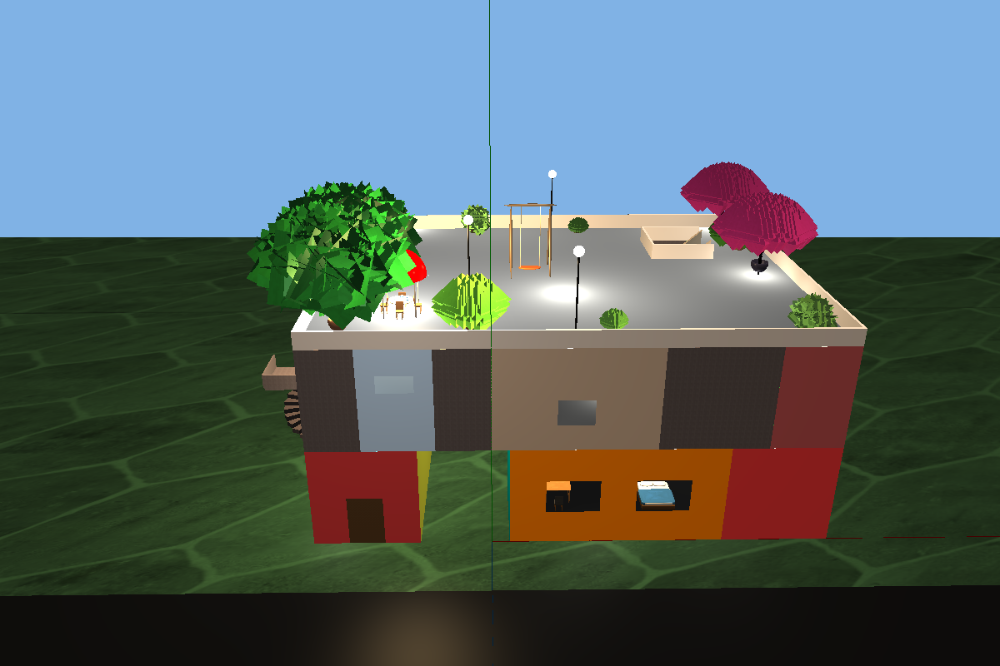
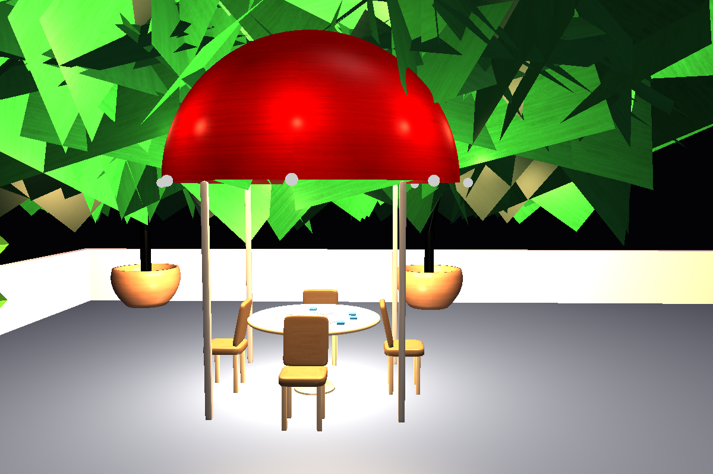
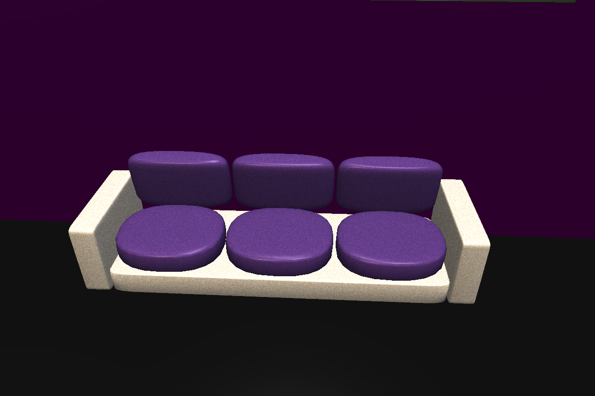
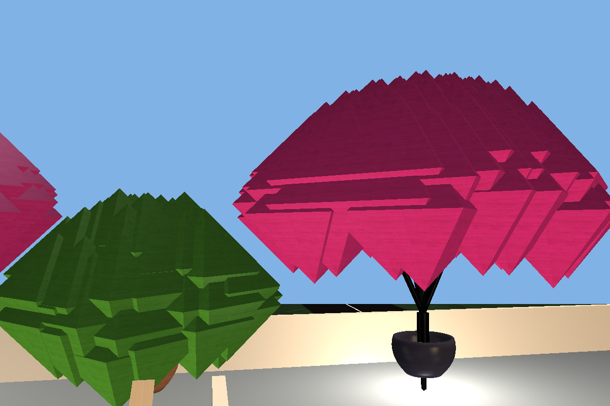
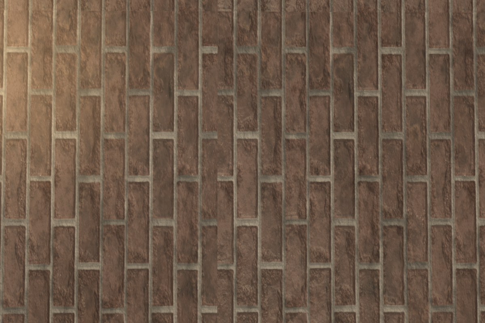
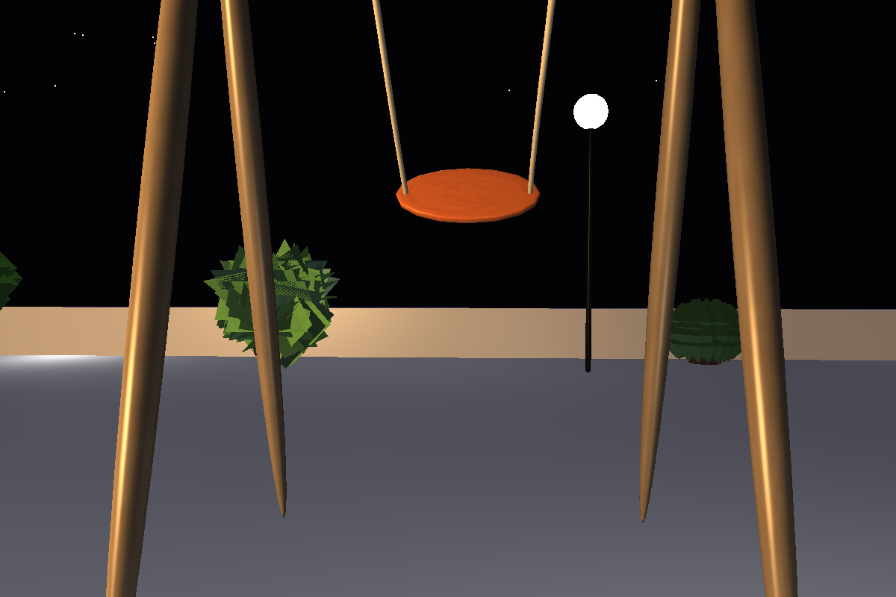

# Apartment Project

A Modern OpenGL (3.3 Core Profile) 3D scene application built with C++, GLFW, GLAD, and GLM. This project demonstrates procedural geometry, interactive elements, custom shading (Phong and Gouraud), and mathematical fractals rendered in a 3D environment.

## 🌟 Features

- **STRICT Modern OpenGL:** No legacy fixed-function pipeline. Fully shader-driven architecture.
- **Procedural Geometry:** Mathematical vertex generation for curves, surfaces of revolution, and procedural furniture.
- **Custom Lighting System:** Day/night cycles with toggleable Directional, Point, and Spotlight sources using both Phong and Gouraud shading models.
- **Interactive Environment:** Interactable objects (doors, swings, furniture) in the world.
- **Testbed Mode:** A dedicated isolated viewer to preview individual procedural meshes.
- **Fractals & L-Systems:** Procedurally generated trees and mathematical shapes.
- **Texture Mapping:** Multiple texture layers and blending (`sampler2D`).
- **Free-Look Camera:** Standard WASD free-look camera to navigate the apartment.

## 🏡 Detailed Scenes & Objects

### Scenes
- **The Apartment Interior:** Includes fully furnished rooms like the bedroom, dining area, and a functional bathroom. The walls and doorways use procedural cutout logic via shaders.
- **The Rooftop & Exterior:** Features a Mini-Golf course setup, outdoor plants, and a day/night skyline with a custom skybox.

### Objects & Procedural Meshes
- **Furniture:** Superellipsoid-based sofas and cushions, procedural beds, dining tables, and chairs.
- **Decor & Nature:** Vases and pots made from surfaces of revolution, spiral staircases, and recursive fractal trees (L-Systems) with customizable foliage.
- **Architectural Details:** Hemisphere domes and torus-based lamps/rings.


### Interactions (Press `E`)
- **Doors & Passages:** Dynamically open and close doors connecting the rooms.
- **Dolna Swing:** A physics-based rope swing built with Bezier tubes.

## 🖼️ Walkthrough & Gallery



### Screenshots








## 🏗️ Architecture

- `main.cpp`: Entry point, window initialization, input handling, and main loop.
- `src/Geometry.*`: Mathematical generation of shapes centered at (0,0,0).
- `src/ProceduralMesh.*`: Advanced curve and shape generation.
- `src/Scene.*`: Placement (Translate -> Rotate -> Scale), scene graph logic, and rendering coordination.
- `shaders/`: Contains GLSL files for core rendering, skybox, room cutouts, and lighting.
- `src/context_files.md` & `project_rules.md`: Internal guidelines and documentation for the architecture.

## 🚀 Build Instructions

This project requires a standard C++ compiler (`g++`) and the following libraries:
- OpenGL (`libGL`)
- GLFW3 (`libglfw`)
- X11 related libraries (for Linux build)

### Compilation Command (Linux)

```bash
g++ main.cpp glad.c src/*.cpp -lglfw -lGL -lX11 -lpthread -lXrandr -lXi -ldl -o apartment
```

Run the application:
```bash
./apartment
```

## 🎮 Controls

### Movement
- **W / A / S / D**: Move Forward / Left / Backward / Right
- **Space / LShift**: Move Up / Down
- **Mouse**: Look around

### Interactions
- **E**: Interact with nearby objects (doors, swings, etc.)
- **T**: Toggle between **World Mode** and **Testbed Mode**
- **N**: Cycle through objects in Testbed Mode
- **X**: Toggle rendering of XYZ axes

### Lighting & Rendering Toggles
- **0**: Toggle Day / Night cycle
- **1**: Toggle Directional Light
- **2**: Toggle Point Light
- **3**: Toggle Roof Spotlights
- **G**: Toggle between Phong and Gouraud Shading
